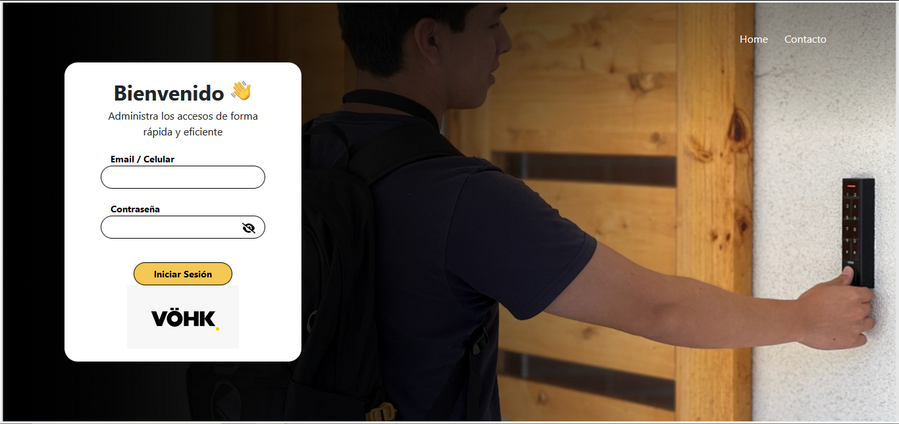
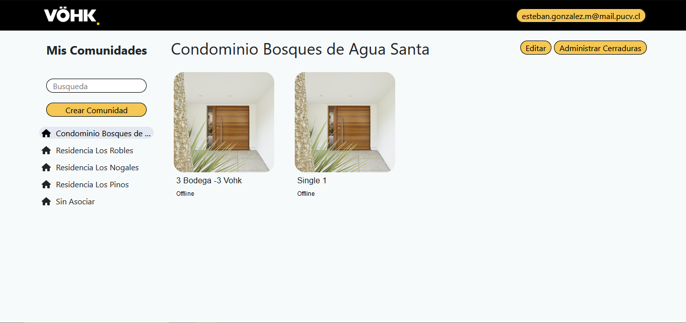
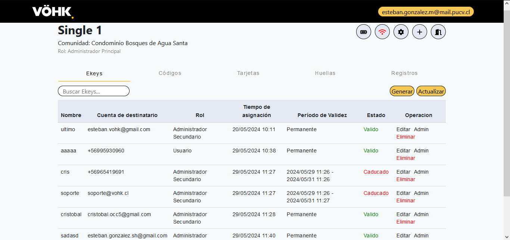

# Sistema web para la administración y gestión de cerraduras inteligentes

## Resumen

Este es el repositorio del Sistema Web para la administración y gestión de cerraduras inteligentes, también llamado de manera no oficial Sistema Vohk. En este sistema web se pueden administrar las cerraduras previamente asociadas con la aplicación móvil Vohk. En este sistema web se pueden realizar las siguientes acciones utilizando la API TTLock:

    Visualizar todos los métodos de apertura de una cerradura.
    Crear nuevos métodos de apertura para una cerradura.
    Editar métodos de apertura existentes de una cerradura.
    Borrar métodos de apertura de una cerradura.
    Visualizar los registros de acceso de una cerradura de los últimos 6 meses.
    Y más.

El sistema se integra con la [API TTLock](https://euopen.ttlock.com/document/doc?urlName=cloud%2FerrorCodeEn.html) para proporcionar estas funcionalidades.
Presione el siguiente [link para ingresar al sistema](https://vohkapp.com)

## Tecnologías

### Runtime oficial

Todo el repositorio se desarrolla, prueba y automatiza con **Node.js 22.16.0** y **npm 10.9.2**. Node 18 o versiones anteriores no son compatibles con las dependencias actuales del backend.

Con NVM para Windows:

```powershell
nvm install 22.16.0
nvm use 22.16.0
node --version
npm --version
```

Los archivos `.nvmrc`, `.node-version`, los campos `engines` de npm y la imagen del `backend/Dockerfile` mantienen esta versión explícita para desarrollo local, Codex/Linear y contenedores.

Frontend

    Angular: Versión 16.2.11

Backend

    Node.js: Versión 22.16.0

## Vistas

### 1. Login

El sistema hace uso de la función API de TTLock "Get access token" para verificar si la cuenta ya existe. De ser así, el token queda guardado temporalmente en el backend para ser usado por la cuenta en futuras funciones.



---

### 2. Comunidades

En esta vista el usuario puede visualizar sus cerraduras de acuerdo a la organización que le dió. De esta manera, solo se cargan las cerraduras de una comunidad a la vez para no demorar el tiempo de carga. Se pueden crear nuevas comunidades, eliminar existentes, o agregar/remover cerraduras a una comunidad. Para avanzar a la siguiente vista, se tiene que presionar sobre una cerradura.



---

### 3. Cerradura

En esta vista se puede visualizar las características de los métodos de acceso de la cerradura. También se pueden visualizar los registros de los últimos 6 meses. Se puede editar el nombre y fecha de validación de los accesos, o bien, eliminarlos.

 

---


